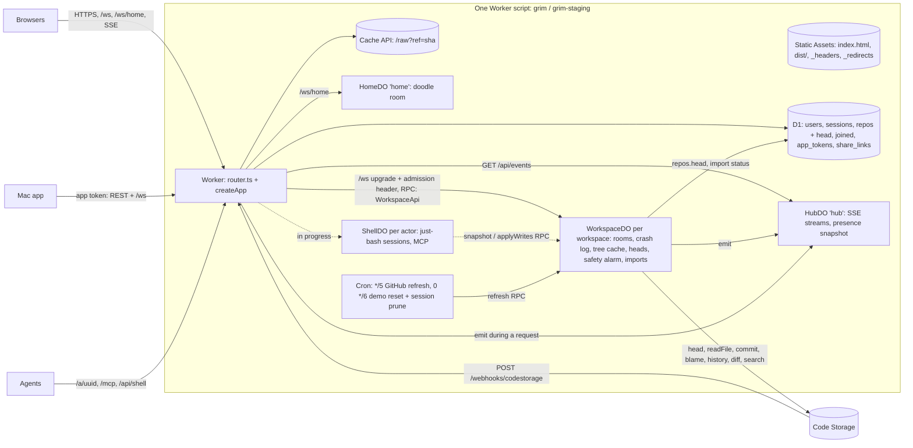

# Grimoire on Cloudflare: architecture as built

> Terminology: a **workspace** is one Git repo (the `repos` table, `/api/workspaces`, `repoId` in code); a **folder** is a directory inside a workspace.

The hosted service ([grimnotes.app](https://grimnotes.app), staging at `staging.grimnotes.app`) runs on Cloudflare Workers and Durable Objects. Self-hosting stays one Bun process (`bun run start`, see [Self-hosting](self-hosting.md)). Both run the same code in `src/server/`. Only three things differ between them, and each is a small interface (a **seam**) with one implementation per runtime. Everything else (routing, auth, the API, rooms, the agent shell, Git stores) is shared.

This doc describes what is in the code today. Parts still being built are marked **(in progress)**. The internal contracts that are the same on both runtimes (API, WebSocket protocol, line authors, shell) are in [V1 architecture](05-v1-architecture.md).

- [Overview](#overview)
- [The Worker](#the-worker-srcworkersindexts-routerts)
- [Durable Objects](#durable-objects)
- [The seams](#the-seams-bun-vs-workers)
- [Hibernation, wake and crash recovery](#hibernation-wake-and-crash-recovery)
- [Caches](#caches)
- [Crons](#crons)
- [Configuration: wrangler, environments, secrets, D1](#configuration-wrangler-environments-secrets-d1)
- [Running and testing the Workers build](#running-and-testing-the-workers-build)
- [Security rules](#security-rules)
- [Known gaps](#known-gaps)
- [Deploying](#deploying)

## Overview



- A request for a static file (the app's HTML, `/dist/*`, CSS, fonts) is answered by **Static Assets** without running the Worker. Only the `run_worker_first` paths reach it: `/api/*`, `/ws*`, `/auth/*`, `/a/*`, `/mcp`, `/connect`, `/webhooks/*`. Other unknown paths (`/app/…`, `/start`, `/scratch`) fall back to `index.html` (single-page-application mode); `_headers` carries the CSP and security headers and `_redirects` the old `/r/*` links.
- The **Worker** is stateless: it authenticates, reads D1, and forwards anything about a workspace to that workspace's Durable Object.
- A **WorkspaceDO** does what the Bun process does for one workspace: live rooms, crash log, commits to Code Storage, merging outside pushes.

| Piece | File | Instances | Storage |
| --- | --- | --- | --- |
| Worker | `src/workers/index.ts`, `router.ts`, `cron.ts` | per request (one shared app per isolate) | none of its own: D1, Cache API |
| `WorkspaceDO` | `src/workers/workspace-do.ts` | one per workspace (`WORKSPACE.getByName(repoId)`) | DO SQLite: crash log, blame cache, branch, presence files, import state |
| `HubDO` | `src/workers/hub-do.ts` | one (`HUB.getByName("hub")`) | DO SQLite: the presence snapshot |
| `HomeDO` | `src/workers/home-do.ts` | one (`HOME.getByName("home")`) | none (memory only) |
| `ShellDO` **(in progress)** | `src/workers/shell-do.ts` | one per actor | DO SQLite: session checkpoints |

All Durable Objects are created with `locationHint: "enam"` (`LOCATION` in `router.ts`), near D1's primary and Code Storage (AWS us-east-2).

## The Worker (`src/workers/index.ts`, `router.ts`)

`index.ts` exports the four Durable Object classes, the `Env` bindings (`ASSETS`, `DB`, `WORKSPACE`, `HUB`, `SHELL`, `HOME`, typed `DurableObjectNamespace<…DO>` for typed RPC) and `{ fetch, scheduled }`.

`createRouter()` builds, on the first request of an isolate, one shared app for that isolate:

- `createApp({ ctx, db, shells, mcpServer, staticFile })` from `src/server/app.ts`, the same router the Bun entry uses. `staticFile` is `env.ASSETS.fetch`.
- A `CachedHeadStore` over the isolate's Git store (`gitStore()`): `CodeStorageStore` when `CODE_STORAGE_ORG` and `CODE_STORAGE_PRIVATE_KEY` are set, otherwise a `MemoryStore` (`wrangler dev` without secrets). The Worker and the Durable Objects of one isolate share it.
- A `RepoService` whose `WorkspaceHost` is `{ get: (id) => env.WORKSPACE.getByName(id, LOCATION) }`, so file operations, tree, history, search, pushes and refreshes go to the workspace's DO by RPC (a new stub per call; stubs belong to the request that made them). Its import scheduler is `{ start: (s) => …startImport(s) }`: GitHub imports run in the new workspace's DO.
- A `RoomManager` that stays empty: its `RoomStorage` throws, because rooms live only in WorkspaceDOs.
- A `Db` facade (`requestDb`, wrapped in `repoCacheDb`) that sends every call to **the current request's** D1 session. Each request gets its own `d1Db(env.DB)` inside an `AsyncLocalStorage` scope. Code that runs outside a request (crons, DOs) makes its own `d1Db`.

Each request:

1. `notePeer(req, CF-Connecting-IP)`. With `TRUSTED_PROXIES=none`, `clientIp()` is Cloudflare's `CF-Connecting-IP`, and `X-Forwarded-For` is never believed.
2. Routing:

| Path | Handled by |
| --- | --- |
| `/ws` | `note()`: 426 without an upgrade; `admitWorkspace(db, req, url)` decides auth (4401), origin (4403), unknown workspace (4404) and a workspace that isn't ready (1013), by **upgrade-then-close** (browsers only see a close code on an open socket). An accepted upgrade is forwarded to `WORKSPACE.getByName(repoId)` with header `X-Grim-Admission` = `encodeURIComponent(JSON.stringify({ repoId, branch, path, participant, readOnly }))`. The Worker always overwrites that header, so a client can't forge it. |
| `/ws/home` | origin check (4403), then `HOME.getByName("home")` with `CF-Connecting-IP` set to the caller's IP (per-IP caps). |
| `GET /api/events` | `HUB.getByName("hub").fetch(req)`, the original request so its abort signal reaches the DO. |
| `/api/shell`, `/mcp`, `/a/*` | 501 JSON until ShellDO lands **(in progress)**. |
| `/api/*` | the shared app, plus the raw-image cache (below) and a `Server-Timing: app;dur=…` header. |
| everything else that reaches the Worker (`/auth/*`, `/connect`, `/webhooks/*`) | the shared app. |

3. Events the shared code emits while handling a request (a new workspace, a rename, …) are forwarded to `HUB.emit` with `waitUntil`.
4. An uncaught error is a 500. The log line names the method and path, with `/a/<uuid>` redacted.

The Code Storage webhook (`POST /webhooks/codestorage`) is verified in the Worker and becomes `host.get(id).onPush(repo, { invalidate: true })` on the workspace's DO.

## Durable Objects

### WorkspaceDO (`src/workers/workspace-do.ts`)

One per workspace, named by the workspace id (`ctx.id.name`). It hosts the workspace's `WorkspaceRuntime` (`src/server/workspace.ts`), the same class the Bun host keeps in a `Map`.

**Constructor**: `DoRoomStorage(ctx.storage)`, then `ensureRoomTables` (`room_meta`, `room_updates`) plus `workspace_meta` (the branch) and `presence_files`; a `CachedHeadStore` over the isolate's store whose `onHeadChange` is `repoHeadWriter(repoCacheDb(d1Db(env.DB)))` (writes `repos.head`, throttled to once per 5 s per branch); a `RoomManager` with `{ closeTimer: false, sweepTimer: false }` (the alarm does both jobs); the `WorkspaceRuntime`.

**RPC**: exactly the `WorkspaceApi` methods (`seams/workspace-host.ts`): `readFile`, `readRaw`, `createFile`, `patchFile`, `appendText`, `restoreFile`, `deleteFile`, `renameFile`, `renameFolder`, `deleteFolder`, `uploadImage`, `tree`, `head`, `history`, `diff`, `search`, `snapshot`, `applyWrites`, `waitForChange`, `onPush`, `refresh`, `seenHead`, `remove`, plus `startImport` and the `fetch`/`alarm`/`webSocket*` handlers. Arguments and results are plain data. Every caller passes the workspace's `RepoRow` as it read it, so the DO never reads `repos` itself. Errors keep their `name` across RPC (`OpError` with `status`, `NotFoundError`, `FileTooLargeError`, `StoreFullError`, `StoreUnavailableError`, `RepoBusyError`; matched with `isErr`/`errStatus` from `errors.ts`, never `instanceof`). Everything else is `#private`, so it can't be called over RPC. Each call records the branch, reopens leftover crash logs first, and clears presence of notes that closed.

**Sockets**: `fetch` reads the admission (`readAdmission`), then `runtime.admitFile(a)` opens the note's room. File-level failures are upgrade-then-close: 4404 (not found), 4413 (over 5 MB), 1013 (store unavailable, or the room closed meanwhile), 1011 (other). An accepted socket is `ctx.acceptWebSocket(server, [pathTag(path)])`: hibernatable, tagged `"p:" + sha256(path)[:32 hex]` because tags are capped at 256 characters. Its attachment (`serializeAttachment`, kept ≤ 1800 bytes of JSON under the 2 KiB cap) holds `{ path, branch, user, readOnly, generation, aw }`, where `aw` is the socket's awareness states. When it doesn't fit, `fit()` drops awareness states first, then the avatar, then shortens long names. The attachment is rewritten on every awareness update of that socket.

**Safety alarm** (one alarm, `ALARM_MS` = 60 s, `WORKSPACE_ALARM_MS` overrides): run a due GitHub import step; reattach sockets; reopen crash logs; for every room: sweep awareness and fetch blame if it's missing; close rooms without sockets once idle (`closeIfIdle`: commit, then drop); with sockets: one fresh head read, then `checkRemote()` (the poll fallback for a missed webhook) and flush if dirty; clear stale presence. It re-arms while rooms, sockets or crash logs exist, so an idle workspace has no alarm and no timers.

**Events**: one bus subscriber per isolate forwards events that carry a `repo` to that workspace's live DO, which sends them to `HubDO.emit`. Events emitted inside a Worker request are skipped (`inRequestScope()`), since the router forwards those. Presence is tracked in `presence_files`: when a note has neither a room nor an open socket any more (closed, deleted, renamed, evicted), the DO emits `presence` with `users: []` so the hub's snapshot doesn't keep it.

**GitHub imports**: `startImport(state)` stores the plain-JSON `ImportState` (`repos.ts`) under the `import` key and sets the alarm to its `at`. Each alarm runs `runDueImport`, one step of the resumable state machine (branch → create → wait → finish; head polls every 3 s). It saves the next state and re-arms. An eviction mid-import resumes from the saved step.

### HubDO (`src/workers/hub-do.ts`)

The `/api/events` fan-out (`EventBus` on Workers). It holds the SSE streams. RPC `emit(e)` fans an event out to every stream in call order; RPC `stats()` is for tests. A new stream gets `: connected`, then the presence snapshot (latest non-empty presence per file, kept in DO SQLite table `presence` so it survives eviction), then live events. The wire format is byte-identical to Bun's (`seams/events.ts`: `sseEvent`, `SSE_*`). The 25 s `: ping` interval runs only while streams exist. A stream more than 256 chunks behind is dropped. A client disconnect reaches the DO through `req.signal`, which needs the `enable_request_signal` compatibility flag.

### HomeDO (`src/workers/home-do.ts`)

The home page doodle room: one unchanged `HomeRoom` (`src/server/home.ts`). It uses the standard `accept()`, not hibernation: strokes and bots live in memory and the bots tick while anyone is connected, so there's nothing to rebuild after a wake. Binary frames arrive as `ArrayBuffer` and are refused without being read. Per-IP caps read the `CF-Connecting-IP` header the Worker sets (4429, 1013 when full). With no clients the bots stop, no timers remain, and the DO is evicted. The doodle starts fresh next time.

### ShellDO (`src/workers/shell-do.ts`) — in progress (CF-28)

Today a stub that answers 501, and the Worker answers `/api/shell`, `/mcp` and `/a/*` with 501 before reaching it. The intended shape:

- One DO per **actor**: `share:<uuid>` for a share link, or the user id for MCP and `/api/shell`. It holds that actor's `ShellSessions` (cwd, variables, `/tmp`), so per-actor limits stay as on Bun, and the share-link limits (120 calls a minute, 4 commands at a time) are strict because one object owns them. MCP sessions route to the same actor's DO.
- just-bash's **browser build**. Wrangler resolves `just-bash` to it. `session.ts` parses with `new Bash().transform(src).ast`, and the `./trust.ts` alias swaps `shell/trust.ts` for `trust.workers.ts` (identity, no `DefenseInDepthBox`). Bun keeps the Node build with defense-in-depth on.
- `NotesFs` talks to the WorkspaceDO by RPC: one `snapshot(repo, sinceVersion)` per command (only what changed since the session's copy) and one `applyWrites` batch at the end, so `grep -rn` over 100 notes is 1–2 RPCs. This part is already in `shell/fs.ts` and goes through the `WorkspaceHost` on both runtimes.
- Session state checkpointed to DO SQLite, `/tmp` capped at 4 MB per session. Revoking a link closes its sessions.
- Budgets: `cat` ≤ 120 ms and `grep -rn` ≤ 200 ms p50 on staging.

### Demo workspace (`src/workers/demo.ts`)

On Bun the demo (`demo.ts`) lives in a `MemoryStore`, reseeded at startup and every `DEMO_RESET_HOURS`. On Workers it is the WorkspaceDO named `demo`, also all in memory: a plain `MemoryStore(demoLimits)` (same limits and `StoreFullError` message as Bun), seeded by each new instance (`openDemo`). Its rooms keep no crash log and its sockets are standard, not hibernatable, so the object stays in memory while anyone is connected; once everyone has left and it is evicted, the next visitor gets the seed again. The demo's D1 row comes from `migrations/0002_demo.sql`, and the Worker also puts it in on the first request naming the demo in each isolate (`ensureDemoRowOnce`), so `/app/demo` works on a fresh deploy. The 6-hourly cron calls the DO's `resetDemo` RPC: rooms discarded, sockets closed with 1013 (clients reload), the seed back.

Hosted servers have **no shared `notes` workspace** (Bun creates `NOTES_REPO` at startup; the Worker doesn't): people signed in create their own, a guest landing on `/app` with nothing to open is sent to `/app/demo`, and `tools/bench.ts --read-only` reads `demo` by default.

## The seams (Bun vs Workers)

Only real platform differences are seams. Their interfaces are in `src/server/seams/`; the Bun implementations are in `src/server/bun/`, the Workers ones in `src/workers/`.

| Seam | What it is | Bun (self-host, tests) | Workers (hosted) |
| --- | --- | --- | --- |
| **`Db`** (`seams/db.ts`) | async `get/all/run/batch` over the global tables (users, sessions, repos, joined, app_tokens, share_links). `batch` is atomic. No interactive transactions: multi-step writes are single statements (`… RETURNING`, `ON CONFLICT`, `WHERE NOT EXISTS`). | `bunDb()` (`bun/db-bun.ts`) over `bun:sqlite` at `$DATA_DIR/grimoire.sqlite` | `d1Db(env.DB, constraint?)` (`workers/db-d1.ts`): one D1 Sessions-API session per `d1Db()`, so reads can come from a nearby replica and later reads see earlier writes; binds `undefined` → NULL and booleans → 0/1 like bun:sqlite |
| **`RoomStorage`** (`seams/room-storage.ts`) | **synchronous** SQL for one workspace's crash log (`room_meta`, `room_updates`) and blobs (`putBlob`/`getBlob`: blame cache, demo store) | `BunRoomStorage` (`bun/room-storage-bun.ts`) on the same SQLite file | `DoRoomStorage` (`workers/room-storage-do.ts`) on `ctx.storage.sql`; blobs in 1 MB rows (`room_blobs(key, idx, data)`, DO SQLite caps rows at 2 MB); `transaction` = `transactionSync` (nests) |
| **`WorkspaceHost`** (`seams/workspace-host.ts`) | `get(repoId): WorkspaceApi`: how the API, shell, MCP, webhook and cron reach one workspace's runtime | `LocalWorkspaceHost` (`bun/workspace-host-local.ts`): a `Map` of `WorkspaceRuntime`s sharing one `RoomManager`; also `admitFile` (the file-level WS step), `recover`, `flushAll` | the `WORKSPACE` namespace: `get(id)` = a WorkspaceDO stub; the DO does `admitFile` in its own `fetch` |
| **`EventBus`** (`seams/events.ts`) | `emit`, `subscribe`, `presence()` for `/api/events` | `LocalEventBus` (`events.ts`), in process | the router and WorkspaceDOs call `HubDO.emit` by RPC |
| `GitStore` (`store/types.ts`, existed before) | Git operations | `LocalGitStore` (git CLI), `CodeStorageStore`, `MemoryStore` (demo) | `CodeStorageStore`; `MemoryStore` for the demo and without secrets |

Keystroke-level change notifications (`notifyChange`/`waitForChange`, the shell's `watch`) are not events: they stay inside the process or DO that hosts the workspace (`runtime.waitForChange` over RPC on Workers).

**Not seams** (handled directly in shared code): timers are `setTimeout` (Room options turn off the close and awareness-sweep timers on Workers; the WorkspaceDO alarm does that work); hashing is `node:crypto` (`src/server/ids.ts`, Bun-free, holds `newId`/`sha256`); `lsRemote` fetches `info/refs` over HTTP; config reads `process.env` (populated from vars and secrets on Workers); static files are `staticResponse` on Bun and Static Assets on Workers; the client IP is `CF-Connecting-IP` on Workers.

How the entries wire them:

- **Bun** (`src/server/index.ts`): `db = repoCacheDb(bunDb())`, `store = CachedHeadStore(RoutedStore(base, { demo: MemoryStore }), { onHeadChange: repoHeadWriter(db) })`, `RoomManager(store, { storage: bunRoomStorage(), db })`, `LocalWorkspaceHost`, `RepoService(store, rooms, db, host)`, `createApp(…)`, `Bun.serve`.
- **Workers**: the router builds the app as above; each WorkspaceDO builds its own `WorkspaceRuntime` over `DoRoomStorage` and a D1 `Db`.

## Hibernation, wake and crash recovery

**The crash log.** Every room writes its Yjs updates to `room_updates (room, seq, data, author)` and its state to `room_meta` (base snapshot and commit, dirty flag, saved time, generation, contributors, line authors in `blame`/`blame_people`/`state`). Updates are buffered 250 ms per room and written as one merged row with one attribution pass. The buffer is flushed early when another author's change is about to land, and before commit, close, save, rename and blame. The log is compacted at each commit and deleted when the room closes cleanly. On Bun it lives in the server's SQLite; on Workers, in the WorkspaceDO's own SQLite, so keystrokes never touch D1 or Code Storage.

**Two ways to open a room** (`src/server/room.ts`):

- `room.open()` (async): with a crash log, `wake()` and then `checkRemote()`; without one, a cold open from the store: the head, then the file and its blame in parallel.
- `room.wake()` (sync, `RoomStorage` only, **0 network calls**): restores the document, base, dirty, savedAt, generation, contributors, line values and the resolved origin authors (cached in a `RoomStorage` blob by origin commit). Returns false when there is no log.

**Hibernation** (Workers). With no pending timers or I/O, a WorkspaceDO hibernates: its memory goes, its sockets stay open. The first message on a socket afterwards calls `RoomManager.wake(repo, path, branch)`, which rebuilds the room from the crash log synchronously. Then `Room.reattach(conn, awareness)` puts back every socket of that note from its attachment, with no hello or resync, awareness restored silently. The frame is applied after that. Missing blame is fetched only after the frame (`ensureBlame`). If there is no log, or the room's generation differs from the attachment's, the socket is closed with 1013 and the client reconnects and resyncs.

**Eviction or deploy** (sockets closed, memory gone). The crash log is still in the DO's SQLite. The DO doesn't reopen rooms in its constructor. Leftover logs are reopened (`#recover`) by the next RPC, the next alarm (which keeps re-arming while `room_meta` has rows), or a reconnecting client's upgrade (`admitFile` → `room.open()`), which finds the same generation, so clients keep their document. Recovered rooms commit as usual.

**Bun** has no hibernation. At startup `host.recover()` reopens every crash log in the database. On SIGTERM `flushAll()` commits every room. Rooms close 60 s after their last connection (`closeTimer`), and awareness is swept every 3 s (`sweepTimer`).

**Commit locks** are per `RoomStorage` (one per Bun process or per DO instance), so a DO reset in a reused isolate never waits on a lock left by the old instance.

## Caches

| Cache | Where | What | Invalidation |
| --- | --- | --- | --- |
| **Auth** (`auth.ts`, `ttl-cache.ts`) | per process / isolate; on with `AUTH_CACHE=1` (Workers var), off by default on Bun | session cookie and app-token lookups by token hash: 60 s (a session never past its `expires_at`); unknown tokens 10 s. A hit makes no D1 query. | `endSession`, `revokeAppToken` (`forgetAppToken`), `forgetUser` (sign-ins, `PATCH /api/me`), in that isolate only. A revoked session can keep working up to 60 s in other isolates. |
| **Workspace rows** (`repo-cache.ts`) | per process / isolate; on with `REPO_CACHE=1` (Workers var) | `SELECT * FROM repos WHERE id = ?` (`repos.get`, `getRepo`, WS admission via `cachedRepo`) for 10 s; only `status = 'ready'` rows, never missing ones | `repoCacheDb(db)` empties it on any statement that writes `repos`, with a generation counter against stale reads. Other isolates and DOs see a change within 10 s. |
| **Heads** (`store/cached-head.ts`) | `CachedHeadStore` in front of every store: one per Bun process, one per WorkspaceDO, one per Worker isolate | the branch head per (repo, branch), updated by its own commits | webhooks (`invalidate`), pollers and the alarm (`{ fresh: true }`). Changed heads go to `repos.head` in D1 (`repoHeadWriter`, ≤ 1 write per 5 s per branch), so `GET /api/workspaces` makes no store calls. |
| **Tree ETag** (`api.ts`) | HTTP | `GET /api/repos/:id/tree` sends an `ETag` (hash of `{head, files}`, pending notes included) and answers `If-None-Match` with 304; `Cache-Control: private, no-cache` | the body changes |
| **Raw images** (`router.ts`) | Cache API (`caches.default`, per Cloudflare location), Workers only | `GET /api/repos/:id/raw?path=…&ref=<40/64-hex sha>`: key = repo + path + ref, stored with `public, max-age=86400, immutable`; `Server-Timing: cache;desc=hit\|miss` | never needed (content at a commit doesn't change). Branch refs and a missing `ref` aren't cached. |
| **Shell file text** (`workspace.ts`) | per runtime, module-level per head (32 MB) | committed text served in `snapshot` | a new head |
| **Joins / share links** (`workspaces.ts`, `shares.ts`) | per process | `recordJoin` skips known (user, workspace) pairs (10k LRU); `share_links.last_used_at` written at most every 5 min per link | n/a |

## Crons

`src/workers/cron.ts`, wired as `scheduled()` in `index.ts`, triggers in `wrangler.jsonc`. A cron runs outside any request, so it makes its own `d1Db(env.DB)`. There is no every-minute job: webhooks cover outside pushes, and the WorkspaceDO alarm polls the head while people are editing.

| Cron | Job | Bun counterpart |
| --- | --- | --- |
| `*/5 * * * *` | `refreshGitHubCopies`: every ready read-only GitHub copy → `WORKSPACE.getByName(id).refresh(row, UPSTREAM_REFRESH_MS / 2)`, 4 at a time; one failure doesn't stop the rest | `RepoService.startPolling` (every `POLL_MS`, plus upstream refresh) |
| `0 */6 * * *` | `resetDemo(env)` (the demo WorkspaceDO's `resetDemo` RPC) and `pruneSessions(db)`; both run, the cron fails if either did | `startDemoResets`; sessions are also pruned at most hourly on a cookie lookup (both runtimes) |

## Configuration: wrangler, environments, secrets, D1

**`wrangler.jsonc`** (top level = the production Worker `grim`):

- `main: src/workers/index.ts`; `compatibility_date` pinned ≤ the pinned workerd's newest date (wrangler 4.123.0 → 2026-08-18) and ≥ 2026-04-21 (error names survive RPC).
- `compatibility_flags`: `nodejs_compat` (`node:crypto`, `node:async_hooks`, `Buffer`, `process.env`) and `enable_request_signal` (SSE disconnects reach HubDO).
- `alias`: `./trust.ts` → `src/server/shell/trust.workers.ts`; `node:fs` → `src/workers/stubs.ts` (config.ts's `*_FILE` secrets; on Workers set the secret itself).
- `build.command` stages `.wrangler/assets/`: `dist/` under `/dist/` (without the `.gz` copies; Cloudflare compresses), and `index.html`, `app.css`, `editor.css`, `_headers`, `_redirects` at the root, so URLs match Bun's. **Run `bun run build:client` first**; the build command only stages.
- `assets`: binding `ASSETS`, `not_found_handling: "single-page-application"`, `run_worker_first` as listed above.
- `vars`: `TRUSTED_PROXIES=none`, `AUTH_CACHE=1`, `REPO_CACHE=1`. `PUBLIC_URL` is set per environment, not at the top level, so local dev keeps the same-origin rule.
- `d1_databases`: binding `DB`, database `grim`, `migrations_dir: migrations`.
- `durable_objects`: `WORKSPACE`, `HUB`, `SHELL`, `HOME`; `migrations` tag `v1` with all four as `new_sqlite_classes`.
- `triggers.crons`: the two above.
- `observability`: enabled, `invocation_logs: false` (see [Security rules](#security-rules)).

**Environments.** Two Workers in the Cloudflare work account, each with its own D1 database: `grim-staging` (D1 `grim-staging`, `staging.grimnotes.app`, the workers.dev URL as a fallback) and `grim` (D1 `grim`, `grimnotes.app`), both Workers Custom Domains. Staging is `env.staging` in `wrangler.jsonc` (added by CF-34; `--env staging` on every wrangler command). Only `grim*` resources may be created or changed in that account.

**Secrets and vars** (`wrangler secret put <NAME> [--env staging]`; Workers has no `<NAME>_FILE`):

| Name | Kind | Notes |
| --- | --- | --- |
| `CODE_STORAGE_ORG` | var or secret | with the key below, selects Code Storage. **Without them the Worker silently uses an in-memory store.** |
| `CODE_STORAGE_PRIVATE_KEY` | secret | the PEM itself (`\n` escapes work) |
| `CODE_STORAGE_WEBHOOK_SECRET` | secret | Code Storage webhook → `$PUBLIC_URL/webhooks/codestorage` |
| `CODE_STORAGE_REPO_PREFIX` | var | prepended to every repo id sent to Code Storage (e.g. `stg-` on staging, which shares production's org); webhooks for other prefixes are ignored |
| `PUBLIC_URL` | var | the public origin of that environment (cookies, OAuth redirects, Origin checks, agent links) |
| `GOOGLE_CLIENT_ID`, `GOOGLE_CLIENT_SECRET` | var, secret | redirect `$PUBLIC_URL/auth/google/callback` |
| `GITHUB_CLIENT_ID`, `GITHUB_CLIENT_SECRET`, `GITHUB_APP_SLUG` | var, secret, var | callback `$PUBLIC_URL/auth/github/callback` |
| `WORKSPACE_ALARM_MS`, `HUB_PING_MS` | var | tests only |

For `wrangler dev`, local values go in `.dev.vars` (ignored by Git) or `--var NAME:value`.

**D1 migrations.** `migrations/0001_init.sql` is the global schema (`0002_demo.sql` adds the demo's row) (it has no room tables; those live in each WorkspaceDO's SQLite). Bun doesn't run migrations: `src/server/db.ts` creates and upgrades the same schema in place at startup, and `test/server/schema.test.ts` checks that a fresh `0001_init.sql` database and a `db.ts` one have the same tables and columns. **A schema change needs both** a new `migrations/000N_….sql` and the in-place upgrade in `db.ts`.

```bash
bunx wrangler d1 migrations apply grim --local                  # wrangler dev's local D1
bunx wrangler d1 migrations apply grim-staging --env staging --remote
bunx wrangler d1 migrations apply grim --remote                 # production (CF-36)
```

## Running and testing the Workers build

```bash
bun run check:workers   # tsc -p tsconfig.workers.json + scripts/check-workers.ts
bun run test:workers    # bun test test/workers (Miniflare 5, in process)
```

- **`check:workers`** typechecks `src/workers` with Workers types (`tsconfig.workers.json`; the main `tsconfig.json` excludes `src/workers`), then `scripts/check-workers.ts` runs `wrangler deploy --dry-run --outdir <tmp>` and fails if the bundle contains `bun:*`, `node:child_process`, an import of `node:fs`, `store/localgit` or `src/server/bun/`. It prints the bundle size (about 2.6 MiB, 600 KiB gzip). Shared code under `src/server/` must stay importable from the Worker: Bun-only code belongs in `src/server/bun/` or in modules only the Bun entry imports (`index.ts`, `db.ts`, `assets.ts`, the local Git store).
- **`test:workers`** runs real workerd through Miniflare 5 with in-memory D1 and DO SQLite (no `.wrangler` state); `migrations/*.sql` are applied to `DB`. `test/workers/miniflare.ts` has `startWorker({ entry, durableObjects, d1 })`, which bundles an entry with `Bun.build`. `router.test.ts` and `workspace.test.ts` configure Miniflare from `wrangler.jsonc` itself (flags, assets, aliases, DOs). Every test lets Miniflare pick a free port (no fixed HTTP or inspector ports), so parallel runs never collide. Worker test entries that import `cloudflare:*` are plain `.js` (`*.worker.js`), since the main tsconfig covers `test/` with Bun types.

| Test | Covers |
| --- | --- |
| `adapters.test.ts` (+ `db-contract.ts`, `room-storage-contract.ts`) | the same `Db` and `RoomStorage` contracts traced on Bun and Workers and compared: batches and rollback, FK, binding, nested transactions, 5 MB blobs surviving eviction |
| `router.test.ts` | routing, D1 reads, 501s, raw cache miss → hit, every WS rejection code, the admission header (and a forged one), `/api/events` and `/ws/home` through their DOs, static files, headers, compression, `/r/` redirects |
| `workspace.test.ts` (~80 s) | two clients converging; forced hibernation with **0 store calls and 0 fetches** on the first frame after wake; awareness restored; eviction with a hanging commit (the unsaved edit survives, same generation); HTTP and RPC ops; named errors; 4404; presence cleared on delete |
| `hub.test.ts`, `home.test.ts` | SSE fan-out, presence snapshot across eviction, ping only while streams exist; the doodle room and its caps |
| `cron.test.ts` | both crons against D1 with a recording WorkspaceDO |

Miniflare's `unsafeEvictDurableObject` waits for the object's pending timers (quiet commit, 250 ms batch, blame, the head writer's trailing write), so tests use a short `QUIET_MS` and simulate "unsaved at eviction" with a hanging commit.

**Local `wrangler dev`:**

```bash
bun run build:client
bunx wrangler d1 migrations apply grim --local
bunx wrangler dev --local --port 9133 --inspector-port 9333 --var ALLOW_DEV_LOGIN:1
# or: bun run dev:workers (wrangler dev --local, port 8787)
```

Without Code Storage secrets the Worker and its DOs share one `MemoryStore` (they share an isolate locally), so nothing persists across restarts except D1 and DO SQLite in `.wrangler/state`. Unlike Bun, the Worker creates no default `notes` workspace: sign in and create a workspace, or open `/app/demo`. Pass `--inspector-port` so parallel `wrangler dev`s don't fight over 9229.

To fire a cron locally: `curl "http://localhost:<port>/cdn-cgi/handler/scheduled?cron=0+*/6+*+*+*"` (wrangler's `/__scheduled` is answered by the static assets' SPA fallback here).

The regular checks still apply to every change: `bunx tsc --noEmit -p .`, `bun test test/server`, `bun test test/editor`, the e2e scripts in `test/e2e/`.

**e2e against the Workers build (`wrangler dev --local`):**

```bash
bun run test:e2e:workers                 # every core suite on Workers, then the parity check (~5 min)
bun scripts/e2e-workers.ts anon shell    # some of them
bun run test:e2e                         # the same suites on Bun
TARGET=workers bun test/e2e/two-users.mjs   # one script; WRANGLER_LOGS=1 shows wrangler's output
bun run test:all                         # tsc, test/server, test/editor, check:workers, test:workers, e2e on both
```

- `test/e2e/target.mjs` picks the server for a script: the Bun server in-process (default, `TARGET=bun`), `TARGET=workers` (the script starts its own `wrangler dev` through `scripts/wrangler-dev.ts`: a temp `--persist-to` dir with the D1 migrations applied, free ports, the script's settings such as `QUIET_MS` as `--var`s, `ALLOW_DEV_LOGIN=1`, `STORAGE=memory`, no Code Storage secrets, stopped at the end), or `BASE_URL=<url>` (a server that's already running, with whatever settings it has).
- Hosted has no shared `notes` workspace, so on Workers the target signs in a helper account and creates one ("Notes", holding Bun's `Welcome.md`); scripts use `T.ws` (`"notes"` on Bun) and `T.appPath`, and pages get it as `WS`. Checks that looked inside the Bun server go through the target: `T.save` (shell `save`), `T.history`, `T.committed`, `T.live`, `T.isOpen`, `T.exists`, `T.sql` (`wrangler d1 execute` on the local D1; scripts that change `repos` that way run with `REPO_CACHE=0`) and `T.resetDemo` (the 6-hourly cron).
- Bun-only checks are skipped with the reason (printed as `skip …`): turning name sign-in off in-process (workspaces), dropping a room and its crash log for a new generation (rust-collab: restart, crash/newgen, crash/conflict), and immutable caching of `?v=` CSS (tree-keys; a known gap below).
- `scripts/e2e-workers.ts` builds the client once, runs each suite (two-users, workspaces, anon, demo, images, links, autoname, blame, tree-keys, newnote-focus, wide-blocks, rust-collab, shell, parity) and prints a pass/fail/skip table.
- `test/e2e/shell.mjs` is the agent shell end to end (share link reads, `sed -i` → `git status`/`git diff` → `who` → `save`, `watch` woken by a person on `/ws`, the per-link limits, revocation mid-command, MCP, `/api/shell`).
- `test/e2e/parity.mjs` runs one black-box HTTP + WebSocket scenario (~100 steps: sign-in, workspaces, notes, files, history, images, share links, shell, MCP, every `/ws` close code, pages, sign-out) against Bun and against `wrangler dev`, and fails on any difference in status codes, JSON shapes (keys and value types), the headers that matter, or WebSocket close codes and first messages.

## Security rules

- **No `Repo`/`GitStorage` object leaves the store.** A Code Storage `Repo` carries the private key in its options. It must never be returned, logged, `structuredClone`d, put in a socket attachment or event, or passed across DO RPC. WorkspaceDO's RPC surface is only `WorkspaceApi` (plain data); the runtime, rooms and store are `#private`. `CodeStorageStore` seals its repos (custom inspect symbol), and `config.ts` makes secrets non-enumerable accessors, so logging `config` can't print them. `test/server/secrets.test.ts` scans for a sentinel key and must stay green. **(CF-31, in progress)** extends it to Workers RPC results, attachments, logs and responses, and fails the lint if a public method in `src/workers/*-do.ts` mentions `Repo` or `GitStorage`.
- **Invocation logs are off** (`observability.logs.invocation_logs: false`): request URLs include share links (`/a/<uuid>` is a capability) and WebSocket tokens (`?token=`). Our own error logs redact `/a/<uuid>`. Don't log request URLs, headers or bodies.
- **Admission is the Worker's.** Durable Objects are reachable only through the Worker. The Worker always overwrites `X-Grim-Admission`, and the WorkspaceDO refuses an upgrade without one or for another workspace.
- **Client IP** comes from `CF-Connecting-IP` only (`TRUSTED_PROXIES=none`). Rate limits and per-IP caps use it.
- **No Bun-only code in the bundle** (`check:workers`), and no `*_FILE` secrets on Workers.
- **Credentials**: the Cloudflare API token never goes in the repo, logs or notes. Task agents don't deploy (`wrangler deploy --dry-run` only).

## Known gaps

As built today (tracked in the rewrite's coordinator):

- The Worker's own `CachedHeadStore` doesn't hear about commits made in WorkspaceDOs, so Worker-side head reads (the tree ETag's head, the `/refresh` answer, `headOf` when `repos.head` is null) can lag. They should read the head from the DO or use a short `maxAgeMs`.
- `ctx.rooms` in the Worker is empty: API presence from `ctx.rooms` and the shell's `save`/`who`/`git status`/`watch` (`shell/commands.ts`) need host methods before they work on Workers (with ShellDO).
- Clients renew awareness every 15 s, so an open tab wakes its WorkspaceDO every 15 s, and each wake replays the crash log since the last commit. To be measured on staging (CF-35).
- `/dist/main.js` and the CSS are served `max-age=0, must-revalidate` with an ETag (Static Assets can't key immutability on `?v=`), so a reload revalidates each.
- Under `wrangler dev`, every `/ws/home` client that leaves logs `Uncaught Error: Network connection lost.` after HomeDO's close handler has run (not in our handlers; `/ws` sockets to WorkspaceDOs, the demo's included, don't). Harmless so far; check `wrangler tail` on staging.
- Without `PUBLIC_URL` (local `wrangler dev`), links the server builds (share links, `/api/server`'s `publicUrl`) say `http://localhost:8787` whatever port it listens on. Deployed environments set `PUBLIC_URL`.
- Deploys restart Durable Objects and disconnect their sockets. Clients reconnect and crash logs are recovered (above).

## Deploying

The staging deploy (CF-34) and the production cutover (CF-36) are run by the coordinator only. Until they fill this in, these are the known prerequisites:

1. `bun run build:client` (the wrangler build step only stages `dist/`).
2. `bun run check:workers` and `bun run test:workers` green.
3. D1 database created (primary `enam`, read replication on) and its id in `wrangler.jsonc`; migrations applied (`--remote`).
4. Secrets and vars set for that environment (table above), `PUBLIC_URL` included.
5. Deploy.
6. Workers Custom Domain attached. If the API token can't attach it, use the dashboard: Workers & Pages → `<worker>` → Settings → Domains & Routes → Add → Custom domain.
7. Code Storage webhook, Google and GitHub callbacks pointed at `PUBLIC_URL`.
8. Smoke tests: e2e, the Mac app, `bin/grimoire`, and `BASE_URL=… bun tools/bench.ts --read-only` against the budgets.

### Staging (`grim-staging`, `staging.grimnotes.app`)

Worker `grim-staging`, D1 `grim-staging` (`759c05d6-2f41-4eec-9501-09e1ab7562bd`, primary ENAM, read replication `auto`), `env.staging` in `wrangler.jsonc`: vars as the top level plus `PUBLIC_URL=https://staging.grimnotes.app`, `STORAGE=codestorage`, `CODE_STORAGE_REPO_PREFIX=stg-` (staging shares production's Code Storage org; its repos are `stg-<id>`), `ALLOW_DEV_LOGIN=1` until Google sign-in is set up; `routes: [{ pattern: "staging.grimnotes.app", custom_domain: true }]` (attached through the API with the work token, no dashboard step; with `routes` set the workers.dev URL is off). Secrets: `CODE_STORAGE_ORG`, `CODE_STORAGE_PRIVATE_KEY`. Durable Object migrations and crons are inherited from the top level.

Deploy only from a clean worktree of `origin/main`:

```bash
git -C <repo> fetch origin && git -C <repo> worktree add /tmp/…/deploy origin/main --detach
cd /tmp/…/deploy && ln -s <repo>/node_modules node_modules
bun run build:client
set -a; . /root/.config/grim/cloudflare.env; set +a     # CLOUDFLARE_API_TOKEN, CLOUDFLARE_ACCOUNT_ID; never print them
bunx wrangler d1 migrations apply grim-staging --env staging --remote
bunx wrangler deploy --env staging
```

Smoke test after a deploy: sign in (`/auth/dev`), create a workspace, create and edit a note, reload, the history shows the commit (`FIRST_EDIT_URL=https://staging.grimnotes.app bun test test/workers/first-edit.test.ts` checks the commit timing); `/app/demo` in two browsers (an edit seen in both, the banner, nothing lost after idling); `BASE_URL=https://staging.grimnotes.app bun tools/bench.ts --read-only`. Remove test workspaces afterwards (`DELETE /api/repos/<id>` as their maker).

Owner step: turn off automatic Cloudflare Web Analytics (RUM) for the grimnotes.app zone; its injected beacon is blocked by our CSP (4 console errors per page load), and the CSP stays as it is.

### Production (`grim`, `grimnotes.app`)

_To be filled in by CF-36: exact commands, the cutover order (webhook, OAuth callbacks, the old VM's "moved" page) and rollback._
