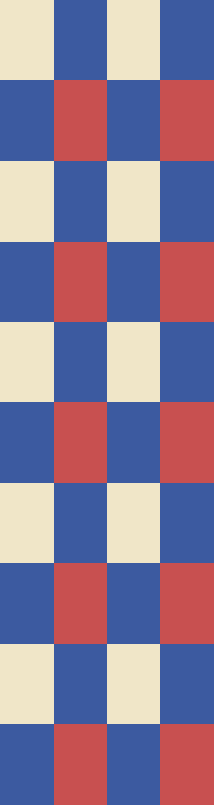

# Trip photos

The sunset from the pier:

A badge inline  in the middle of a sentence, with more words after it so it wraps.

This one is gone: 

Last line.

Two badges, the second with an angle-bracket source, and a linked badge:

